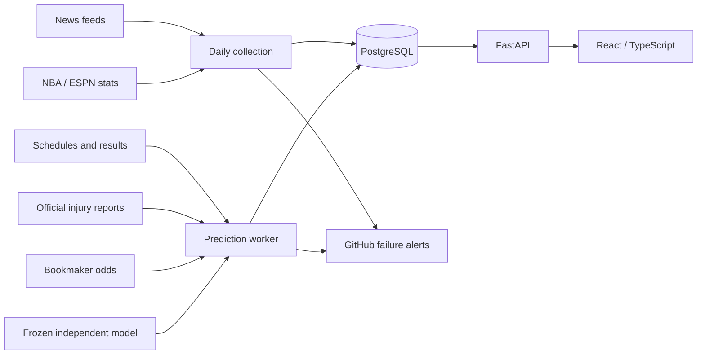

# Court Side

An automated NBA briefing, stats dashboard and independent game prediction system.
Groups news into distinct stories, ranks the coverage, and records pregame win
probabilities alongside bookmaker odds and final results.

**[Deployed site](https://courtside-agent.vercel.app)** · [Setup](docs/setup.md) · [Model & evaluation](docs/predictions.md)

## What it does

- Collects news and statistics daily at 6 AM Eastern. Related coverage becomes one story with original source links.
- Predicts game winners using team strength, opponent-adjusted scoring margins, venue, rest and confirmed player absences.
- Refreshes predictions and injuries at 6 AM and hourly from noon through 11 PM Eastern. Bookmaker odds are comparisons, not model inputs.
- Keeps each version of a forecast in PostgreSQL and scores the latest valid prediction recorded at least one hour before tipoff.
- Separates live results from historical research. Browse the previous seven days under **Predictions → Past results**.
- Opens an assigned GitHub issue on collection failure and closes it when the workflow recovers. Repeat failures update the same issue.

## Evaluation

The original model was selected through chronological validation, frozen, then
evaluated on **501 games from February 1–April 12, 2026**. It correctly picked
**375 winners (74.9%)**, with a **0.1795 Brier score**. Elo picked 374 winners
(74.7%), with a 0.1827 Brier score on the same games.

An injury adjustment selected using earlier January games retained **375/501**
correct picks and improved Brier to **0.1786** in a comparison using the same historical games.
The injury comparison reused the original test games, so it is not a separate test on unseen games.
Backend performance totals use recorded forecasts and exclude these research games.
See [evaluation and production details](docs/predictions.md).

## Architecture



GitHub Actions collects and updates the data. FastAPI serves saved records; page loads and
filters do not spend provider API credits. React/Vite is hosted on Vercel, the
API on Render, and PostgreSQL on Neon. SQLite supports local development.
No LLM calls run in the scheduled production jobs.

## Run locally

Follow [setup](docs/setup.md) for environment variables, database migration and
backend startup. Sample news works without provider keys. Never place credentials
in browser variables or commit `.env`.

```sh
npm --prefix frontend install
npm --prefix frontend run dev
```

## News investigator checks

The offline runner uses 15 fictional cases to check citations, source restrictions
and tool use. It also saves each answer and a checklist for reviewing its meaning.
These are development checks, not model accuracy results or independent human review.

```sh
.venv/bin/python -m courtside.evals.run_news
.venv/bin/python -m courtside.evals.run_news --cases courtside/evals/news_cases_hard.json --output courtside/artifacts/evals/news-hard
```

Results are written to `courtside/artifacts/evals/news/`. The runner makes no
model calls. It does not change the site or collect new articles. The reserved
cases are excluded from development runs.

## Checks

```sh
.venv/bin/python -m unittest discover -s courtside -t .
npm --prefix frontend test
npm --prefix frontend run build
```

[Architecture](docs/architecture.md) · [Ranking](docs/ranking.md) · [Deployment](docs/deployment.md)
