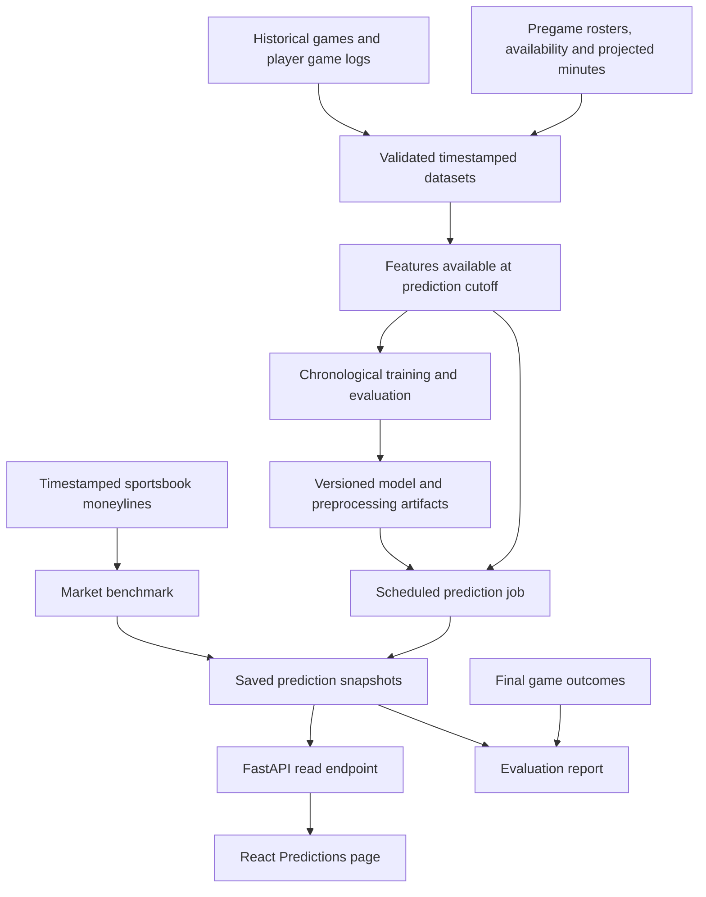

# Matchup predictions: implementation blueprint

Status: historical collectors, team/player features, offline logistic/Elo
benchmarks, a player-embedding model, and optional teammate attention are implemented.
A prediction API and the prediction page remain planned. Work lives on `feature/matchup-predictions`.

## Scope

Predict the probability that the home team wins an upcoming NBA game, including
overtime. Start with regular-season games and pregame predictions. Compare with
timestamped moneyline probabilities. Spreads and live in-game predictions are
separate future projects.

The first milestone is a reproducible historical baseline. Embeddings and player
synergy are experiments whose value must be established on later games.

The [data source audit](prediction-data-sources.md) records provider options,
sample access checks, gaps, and the recommended collection order.
The [baseline feature specification](prediction-features.md) describes implemented
team inputs, cutoff rules, and historical availability assumptions.
The [first baseline report](prediction-baseline.md) documents the reproducible
training run, chronological evaluation, and observed limitations.
The [rolling evaluation specification](prediction-rolling.md) adds full-season
count audits and predefined multi-season development windows.
The [Elo benchmark](prediction-elo.md) compares team ratings with the same saved
logistic predictions before introducing player embeddings and synergy.
The [player pipeline](prediction-players.md) collects box-score observations and
builds lagged statistical vectors with estimated rotations for embedding experiments.
The [first player model](prediction-player-model.md) expands player coverage to
both full seasons and trains a minute-weighted encoder as an Elo correction.
The [identity ablation](prediction-identity-ablation.md) tests that encoder without
player identity; the initial development results show no clear identity benefit.
The [synergy experiment](prediction-synergy.md) adds masked teammate attention;
its initial gain is small and uncertain on the existing development windows.

## System layout



Training is a local/offline job. The production web process loads saved results;
opening a page must not train a model or call a stats/odds provider. Prediction
collection will have its own job rather than extending the news investigator.
Use existing SQLite/PostgreSQL conventions when persistence is implemented.

## Model layout

1. Baselines: home-win frequency, team-strength logistic regression, then gradient
   boosting with team features and minutes-weighted player features.
2. Player encoder: shared small neural network consumes a small player identity
   embedding, age, lagged recent/long-term stats, and missing-data indicators.
   An unknown-player embedding plus statistical inputs supports unseen players.
3. Player synergy layer: one or two small self-attention layers over each team's
   available player vectors. Mask padding; omit positional encodings so input
   order cannot change a prediction. Aggregate using projected minutes.
4. Matchup head: combine both roster representations with pregame team strength,
   home court, rest, and back-to-back indicators. Output home-win probability;
   away-win probability is its complement. Fit calibration on later validation
   data separate from model fitting.

Roster attention approximates fit; it does not establish which players actually
share the court. Exact lineup interactions and opponent cross-attention are later
experiments. Do not interpret attention weights as causal player contributions.

Recent inputs update the representation of a player's current ability. Learned
identity embeddings update only during scheduled training using past data.
Start with small networks, regularization, and early stopping. Keep the simpler
model if it performs better.

## Data contracts and cutoff rules

All timestamps are timezone-aware UTC; the page groups dates in America/New_York.
Use stable provider game/player/team IDs with explicit cross-provider mappings.

| Dataset | Required information |
| --- | --- |
| Games | Game ID, season, phase, scheduled start, home/away IDs, final result and result availability time |
| Player game logs | Player/team/game IDs, minutes, feature statistics, time the record became available |
| Pregame roster snapshots | Game/player/team IDs, availability, projected minutes, source, snapshot availability time |
| Odds snapshots | Game ID, bookmaker, both moneylines, provider timestamp and retrieval time |
| Feature snapshots | Game ID, prediction cutoff, feature version, source record references |
| Predictions | Game ID, cutoff, generation time, home probability, model version, data-quality status |
| Experiments | Dataset version, code revision, configuration, seed, date splits, metrics and fitted artifact references |

Never substitute actual minutes, final-season averages, current rosters, or final
injury statuses for historical pregame information. Historical availability may
be difficult to obtain: first audit coverage, then decide whether to use a clearly
labeled lagged-minutes proxy. A proxy backtest cannot claim injury-aware accuracy.
Projected team minutes should total 240 for regulation; handle overtime separately.

Current cached season averages in `courtside/stats.py` are for display and cannot
serve as historical training snapshots. Research provider coverage and access
terms before implementing an importer or buying data.

Initial cutoff policy: 60 minutes before the scheduled tipoff, using the latest
source records available at or before that cutoff. Record schedule changes and
explicitly skip games with unusable inputs. For morning predictions, use a separate
cutoff policy and evaluate it separately. Do not label retrospective reconstructions
as predictions actually generated before tipoff.

Keep odds out of the initial forecasting features. Convert both sides to implied
probabilities and normalize their sum to one for the market benchmark. Retain the
original offered odds for any simulated-return calculation. Market probabilities
and offered-price break-even probabilities are different quantities.

## Backtest and success criteria

- Train through 2023–24; tune on 2024–25; reserve 2025–26 for the final test.
  Adjust dates explicitly if provider coverage requires it, before examining test
  results. A test used repeatedly for architecture selection becomes validation.
- Fit scalers, imputation, player embeddings, and calibration using the permitted
  training/validation periods only. Start with frozen test-period weights; if
  evaluating rolling retraining, predefine its schedule and use past outcomes only.
- Compare models on identical eligible games. Report exclusions, odds/roster
  coverage, and performance on the common market-comparison subset separately.
- Primary: log loss and Brier score. Also report calibration plots, accuracy,
  sample counts, and uncertainty for paired score improvements (resampling game
  dates to preserve some within-day dependence).
- Ablations: team baseline → player features → embeddings → synergy layer.
  Changing one component at a time tests whether it adds useful information.
- Compare against same-cutoff margin-adjusted market probabilities. Closing odds
  are a separate later-information benchmark.
- Edge buckets and simulated flat-stake ROI are secondary. Set selection rules
  on validation data, use actual offered prices, and disclose sample size and
  uncertainty. The number of disagreements with the market is not evidence of skill.
- Save live predictions immutably before tipoff and evaluate them after outcomes
  become available. Report live results separately from historical backtests.

## Proposed page layout

Route: `/predictions`; navigation label: Predictions.

```text
PREDICTIONS                    Date selector / Eastern date
Model version • prediction cutoff • data freshness

Today's matchups
┌────────────────────────────────────────────────────────┐
│ Away at Home                         Scheduled tipoff  │
│ Home win: model 62% | market 58% | difference +4 pp      │
│ Away win: model 38% | market 42% | difference −4 pp      │
│ Odds source/time • availability coverage • model status │
└────────────────────────────────────────────────────────┘

Performance: test period / game count / Brier / log loss
Model vs baseline vs market • calibration chart
Method: inputs, cutoff policy, limitations, experiment report
```

Numbers above are illustrative. Missing odds display as unavailable; missing
model artifacts display an explicit not-trained state. Never substitute random
or sample probabilities into the live view. Distinguish final historical results
from upcoming games, and label differences as percentage points.

## Intended source layout

```text
courtside/predictions/
  contracts.py           # Initial internal record contracts
  ingest/                # Later: provider adapters and ID mapping
  features.py            # Later: cutoff-safe feature construction
  minutes.py             # Later: pregame rotation projections
  models/                # Later: baselines, encoder, synergy model
  train.py               # Later: reproducible training entry point
  evaluate.py            # Later: backtests, ablations, reports
  service.py             # Later: saved prediction reads/writes
scripts/predict_daily.py # Later: scheduled snapshot generation
frontend/src/PredictionsPage.tsx # Later: saved-result display
```

Large raw datasets, fitted weights, and generated reports stay under ignored
`artifacts/predictions/`. Small synthetic fixtures and experiment configurations
can be versioned. Keep ML dependencies separate from web runtime requirements.

## Implementation order

1. Audit historical games, player logs, roster/availability, and odds coverage.
   Produce a coverage report and select a dataset/provider strategy.
2. Implement ingestion, ID mappings, time validation, and small synthetic fixtures.
3. Build cutoff-safe team/player features and a reproducible baseline backtest.
4. Add embeddings, then synergy, with controlled comparisons.
5. Implement saved snapshots, a read-only API, and the Predictions page.
6. Start scheduled live collection and publish out-of-sample performance.

## References

- [NBA2Vec](https://arxiv.org/abs/2302.13386): player embeddings trained on possession outcomes.
- [Deep Sets](https://arxiv.org/abs/1703.06114): modeling unordered sets.
- [L-RAPM](https://arxiv.org/abs/2601.15000): sparse lineup estimates and player-informed priors.
- [Probability calibration](https://scikit-learn.org/stable/modules/calibration.html).
- [Historical odds](https://the-odds-api.com/historical-odds-data/): timestamped snapshots; paid access.
